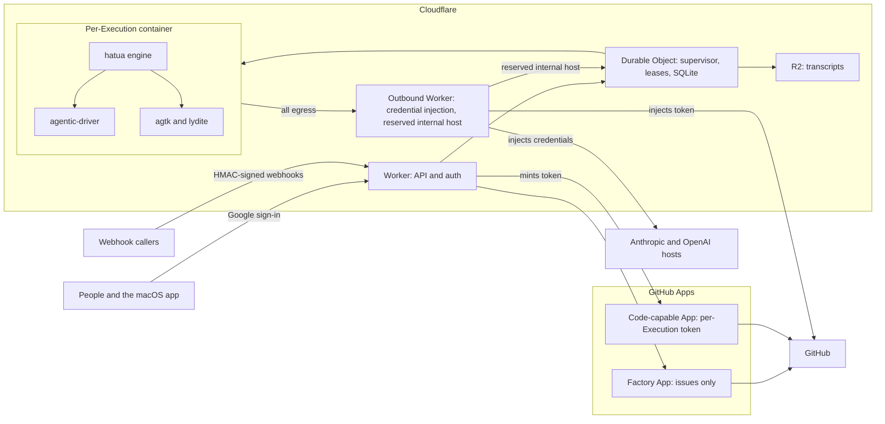
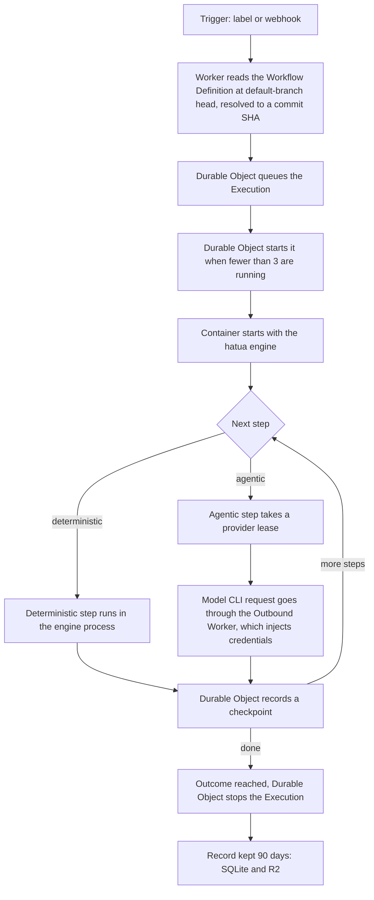

# agentic-toolkit-factory

The **Factory** runs [agentic-toolkit](https://github.com/pedromvgomes/agentic-toolkit)
**Workflow Definition**s as **Workflow Execution**s: one container per Execution, supervised by a
Durable Object, with a fixed number running at once. It acts as the **Factory App**, with issue
permissions and no access to code. Code-capable work uses a per-Execution token of a second
GitHub App, narrowed to one repository and never placed in the container
([ADR 0003](docs/adr/0003-code-access-comes-from-a-per-execution-token-of-a-second-app.md)).

The vocabulary is agentic-toolkit's; see [CONTEXT.md](CONTEXT.md).

## Vocabulary of this design

These terms belong to this design and are not in CONTEXT.md. The **Launcher** is the part of
`agtk-factory` that starts every model session through agentic-driver, naming a provider and
leaving the CLI invocation to the driver. A **Lease** is a hold on a model provider that an
agentic step takes while it runs (claude has 3, openai has 1); it has a TTL and is kept alive
while the step runs, so a lease held by a dead container expires. A **Checkpoint** is what the
Durable Object records after every step, so an interrupted Execution resumes from its last
successful step. The **Outbound Worker** intercepts the container's outbound requests: it swaps
placeholder credentials for the real ones per host, and it is the container's only path to the
Durable Object, through a reserved internal host.

## Architecture

### Components



### One Workflow Execution



## Decisions

- [ADR 0001](docs/adr/0001-model-sessions-are-launched-through-agentic-driver.md): model sessions are launched through agentic-driver.
- [ADR 0002](docs/adr/0002-subscription-credentials-are-injected-and-never-enter-the-container.md): subscription credentials are injected and never enter the container.
- [ADR 0003](docs/adr/0003-code-access-comes-from-a-per-execution-token-of-a-second-app.md): code access comes from a per-Execution token of a second GitHub App.
- [ADR 0004](docs/adr/0004-the-factorys-unit-is-the-workflow-definition.md): the Factory's unit is the Workflow Definition.
- [ADR 0005](docs/adr/0005-people-sign-in-with-google-and-callers-sign-webhooks.md): people sign in with Google and callers sign webhooks.
- [ADR 0006](docs/adr/0006-one-container-per-execution-supervised-by-a-durable-object.md): one container per Execution, supervised by a Durable Object.
- [ADR 0007](docs/adr/0007-values-in-agentic-prompts-are-delimited-as-data.md): values in agentic prompts are delimited as data.
- [ADR 0008](docs/adr/0008-execution-records-live-in-durable-object-sqlite-and-r2.md): Execution records live in Durable Object SQLite and R2.
- [ADR 0009](docs/adr/0009-the-image-is-rebuilt-when-agtk-or-lydite-releases.md): the image is rebuilt when agtk or lydite releases.

## Develop

The repo is set up with [gt](https://github.com/pedromvgomes/gt) (bare repo + worktrees,
governance in [`.gt-repo.yaml`](.gt-repo.yaml)), [agentic-toolkit](https://github.com/pedromvgomes/agentic-toolkit)
(agent configuration in [`.agentic-toolkit.yaml`](.agentic-toolkit.yaml), rendered by
`agtk render`) and [lydite](https://github.com/lydite/lydite) (scanning, tests and coverage
gates declared in [`.lydite/`](.lydite/)).

All code lives under `source/`, one Go module per project; the Factory itself is
[`source/factory`](source/factory).

```sh
gt clone pedromvgomes/agentic-toolkit-factory   # runs agtk sync through .gt.yaml
cd source/factory && go test -race ./...
lydite scan --dir .
lydite test --dir .
```

## Licence

[MIT](LICENSE)
